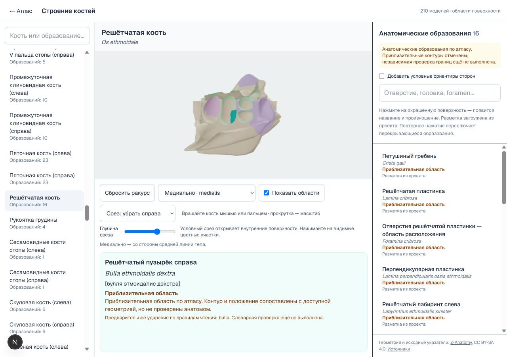

# Проверка анатомических областей в браузере — 19.10.2026

Проверены все 2 432 именованные анатомические области на 210 моделях локальной страницы `/osteology`. Условные ориентиры сторон, включаемые отдельным флажком, в этот перечень не входят. Это функциональная проверка выбора и отображения, а не подтверждение анатомической точности приблизительных границ или словарная проверка ударений.

## Метод

Для каждой области сначала открывалась её подпись в списке. Видимая бирюзовая подсветка находилась на снимке браузера; точка выбиралась внутри окрашенного участка. Затем выбиралось другое образование и выполнялось настоящее нажатие на canvas. Проверялись русский и латинский текст, наличие кириллической транскрипции и совпадение пиксельной маски подсветки до и после нажатия (IoU > 0,85). При наложении областей использовалось повторное нажатие. Для четырёх моделей с единственной областью выбор сбрасывался переходом на другую кость и обратно.

Основной проход оставил 142 случая для повторной проверки. После дополнительных ракурсов и выбора точки дальше от границы осталось шесть закрытых внутренних участков. Их проверка завершена после добавления режима среза. Каждая из 2 432 областей имеет успешный результат в [полном протоколе](verification/all-surfaces-browser-2026-10-19.json); первоначальные неудачные попытки сохранены там же, отдельно от итоговых результатов.

## Исправление просмотра внутренних поверхностей

Добавлен список «Срез кости» и ползунок глубины. Срез временно скрывает выбранную часть модели и открывает внутренние поверхности. Геометрические файлы и маски разметки не изменены. Это условный срез поверхности без построения заполненной плоскости разреза или реконструкции тканей.

Выбор мышью учитывает ту же плоскость, что и отрисовка: скрытая стенка не перехватывает нажатия на открывшуюся поверхность. По умолчанию срез выключен; переход на другую кость возвращает обычный вид. Отключение среза и обычный выбор дополнительно проверены на решётчатой, бедренной кости и C4.

| Область | Ракурс | Срез | Положение ползунка* |
| --- | --- | --- | --- |
| Крыловидный канал | Сзади | Убрать сзади | 0,12 |
| Крестцовый канал | Сзади | Убрать сзади | 0,35 |
| Верхняя носовая раковина слева | Латерально | Убрать слева | 0,32 |
| Решётчатый пузырёк слева | Латерально | Убрать слева | 0,32 |
| Верхняя носовая раковина справа | Медиально | Убрать справа | 0,32 |
| Решётчатый пузырёк справа | Медиально | Убрать справа | 0,32 |

*Значение ползунка в диапазоне −1…1; сохранено в протоколе для воспроизведения. Для крыловидного канала использовано увеличение колёсиком. Крестцовый канал также имеет узкие доступные наклонные направления, но на срезе выбирается значительно удобнее.

Полнота проверена по 210 названиям моделей и 2 432 уникальным парам русских/латинских названий в браузере. Нижняя панель расположена под областью модели; приблизительные границы и предварительные ударения остаются отмеченными. Временный размер окна 1280×900 использован для одновременной проверки canvas и панели и сброшен после завершения.

Диагностика закрытых участков: `scripts/check-hidden-surfaces.ts`. Регрессионные тесты среза проверяют выбор внутреннего треугольника после удаления передней стенки, сохранение пересечений других объектов и восстановление обычного выбора без среза.

Итоговые проверки: 66 тестовых файлов, 460 тестов — успешно; TypeScript, ESLint для изменённых файлов и `git diff --check` — без ошибок. Изменения сохранены локально, публикация не выполнялась.

## Автоматическое открытие внутренних областей — 19 октября 2026

Для шести областей из таблицы выше выбор в списке или на модели теперь автоматически применяет сохранённый срез, глубину и ракурс. Повторный выбор восстанавливает камеру после ручного вращения и масштабирования. Ползунок остаётся доступен для дополнительного исследования; выбирать его положение вручную больше не требуется. Выбор наружной области автоматически отключает срез и выбирает ракурс по геометрии. Смена кости сбрасывает настройки.

В браузере проверены все шесть автоматических настроек, русские/латинские подписи и транскрипции в нижней панели. Дополнительно проверены повторный выбор после вращения и нажатие на правый решётчатый пузырёк на модели. Протокол: `verification/auto-internal-selection.json`; снимок: `verification/auto-internal-selection.jpg`.

Новые тесты проверяют реальные маски и геометрию: из каждой сохранённой позиции камеры после среза луч достигает хотя бы одного треугольника выбранного образования. Вместе с тестами среза — 8 успешных тестов. TypeScript и ESLint пройдены. Разметка и отметки приблизительности не изменялись.

### Автоматический ракурс наружных областей

Все области без внутреннего пресета используют общий подбор из шести стандартных ракурсов. До 32 треугольников текущей маски проверяются лучами на перекрытие остальной геометрией; выбирается ракурс с наибольшей видимой проекцией выборки. Поэтому ракурс определяется фактической разметкой, а не названием или положением вынесенной подписи. Это эвристика стандартных ракурсов, не гарантия оптимального обзора каждой точки сложной поверхности. Пустая маска возвращает передний вид. Левые и правые кости используют соответствующие медиальное/латеральное направления.

Проверены в браузере переходы от крыловидного канала к гипофизарной ямке и от крестцового канала к тазовой, дорсальной и ушковидной поверхностям. Срез выключается, ползунок скрывается, подписи и транскрипция остаются внизу. Снимок: `verification/auto-exterior-selection.jpg`. Тесты поворота, внутренних пресетов и среза: 11 успешных; TypeScript и ESLint пройдены. Всё локально.
