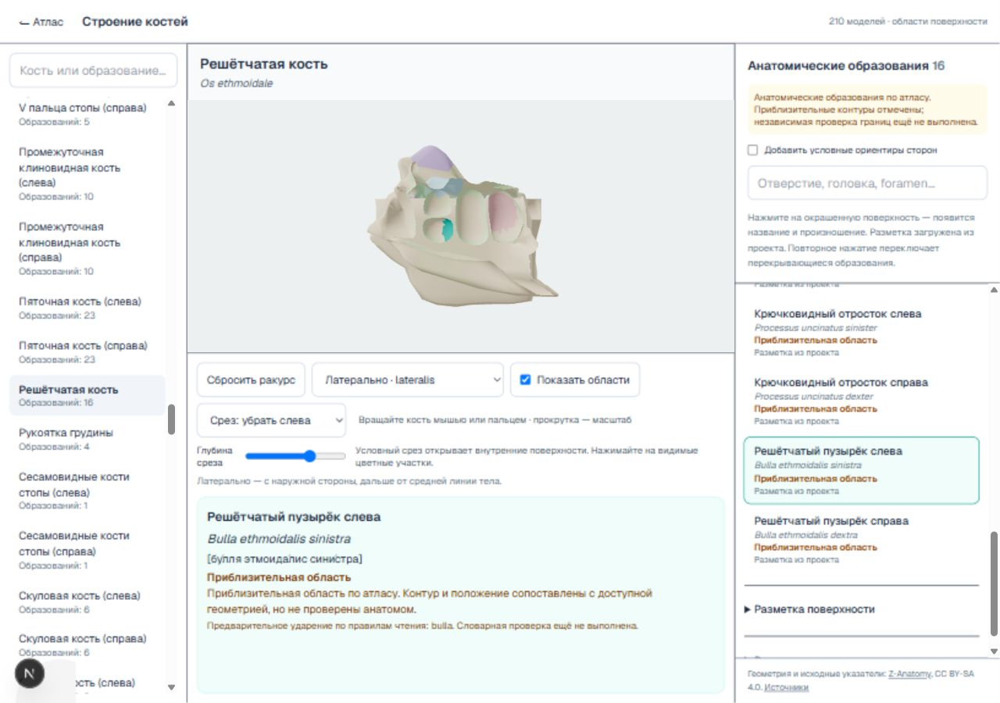
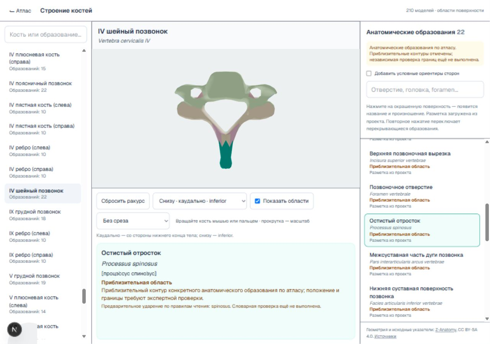

# Проверка автоматического поворота и среза — 20 октября 2026

В локальном браузере проверены **210 моделей, 2432 уникальные анатомические области**. Ошибок по перечисленным ниже критериям не обнаружено. Исправления программного кода не потребовались.

## Метод

Для каждой кости последовательно нажаты все кнопки анатомических образований в списке. После выбора использовались только автоматически установленные ракурс и срез, без ручной настройки камеры или ползунка.

- На снимке экрана проверялась видимая бирюзовая подсветка внутри области 3D-модели. Минимальная зарегистрированная подсветка — 19 пикселей при окне 1280×900.
- Русское и латинское названия нижней панели сверялись с выбранной кнопкой; проверялось наличие транскрипции в квадратных скобках.
- Начиная с проверки №309 дополнительно записывалось положение панели относительно нижней границы модели по DOM. В первых 308 случаях этот отдельный признак не записывался; снимки для проверки подсветки получались с той же компоновкой.
- У всех шести внутренних областей включился предусмотренный срез. При остальных выборах срез был выключен.
- Дополнительно проверены переходы между внутренней и наружной областью решётчатой кости: срез отключается и затем восстанавливается с глубиной 0,32.

Это функциональная проверка автоматического показа текущей разметки. Она не подтверждает анатомическую точность контуров, правильность каждого ударения или оптимальность выбранного ракурса. Приблизительные границы и предварительные ударения остались отмечены. Условные ориентиры сторон не включены в 2432 анатомические области.

Нажатия на саму 3D-поверхность для всех областей проверялись на предыдущем этапе; в этом проходе проверялся автоматический показ после выбора из списка.

## Результаты

Полный протокол с отдельной строкой для каждого образования: [auto-all-browser-2026-10-20.json](verification/auto-all-browser-2026-10-20.json).

| Внутренняя область | Срез | Пикселей подсветки |
| --- | --- | ---: |
| Крыловидный канал | Сзади | 24 |
| Крестцовый канал | Сзади | 149 |
| Верхняя носовая раковина слева | Слева | 1542 |
| Верхняя носовая раковина справа | Справа | 1686 |
| Решётчатый пузырёк слева | Слева | 308 |
| Решётчатый пузырёк справа | Справа | 429 |

Повторно запущены тесты `exterior-view`, `internal-views`, `section`: **11 тестов, 3 файла — успешно**. Временный размер браузера сброшен; открыта модель C4. Отчёт и доказательства сохранены локально. GitHub и Railway не использовались.
